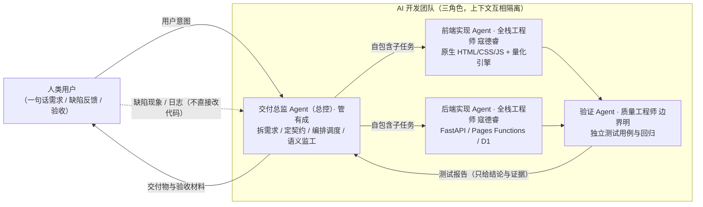

# 拼豆图纸生成器 —— 一个人带领 AI Agent 团队，从 0 到上线的完整实录

> 用户上传一张图片，系统自动转成拼豆图纸（网格 + 分区编码 + 色号用量表），并可导出分块图与全景图。**这是作者担任「AI Agent 团队指挥官」的一次真实演练：一个人，带领一支三角色 AI 团队，在 8 小时 40 分内把一个想法做成了上线的产品，并在约 11 小时内完成全部收尾。**

- 作者：洋
- GitHub：[@xijiuyang](https://github.com/xijiuyang)
- 交付周期：约 11 小时（2026-10-02 17:50 起步 → 2026-10-03 04:56 收尾；其中到上线为 **8 小时 40 分**，即 17:50 → 次日 02:30）
- 上线成本：0 元

## 这个项目真正想证明什么

它想证明的不是「AI 能写代码」，而是**一个人可以统领一支 AI Agent 团队，并把项目从 0 做到上线**。

代码是 AI 写的，但让代码变成产品的那些关键动作，是人做的：需求怎么拆、契约怎么定、活怎么派、AI 跑偏时怎么纠偏、产出怎么验收。这是一个**人类决策 — AI 执行 — 人类验收**的循环，人在循环的最高节点，而不是站在旁边看。

**一支三角色 AI 团队**（角色设定与协作铁律见 [prompts/agent_roles.md](prompts/agent_roles.md)，当时的系统提示词见 [prompts/system_prompt.md](prompts/system_prompt.md)）：

> 注意：下面这三位是**有名字的 AI Agent 角色**，不是真人同事。真正的人只有一位——作者本人，他不写代码、不做测试，在这支 AI 团队之上负责决策与验收。

| 角色 | 干什么 | 明确不干什么 |
|---|---|---|
| 交付总监 管有成 | 拆需求、定接口契约、编排调度、语义监工、汇总交付 | 不写代码、不做验收判断 |
| 全栈工程师 寇德睿 | 前后端与算法实现、自检 | 不宣布验收通过、不自行扩展需求 |
| 质量工程师 边界明 | 独立设计测试用例、执行回归验证 | 不改代码、不采信实现者的结论 |

给它们起名字不是为了拟人化，而是为了**把职责边界钉死**：交给人做的判断不能由执行者代劳，验证结论也不能由写代码的人给出。

**人在循环里只做三件事：给意图、拍决策、做验收。** 具体到本项目，人是这样介入的：

- 拍板技术路线（否决了前端框架方案，选定零构建原生实现）；
- 亲自上手体验并反馈缺陷（「一直在转圈」「色块分辨模糊」「保存的图片去哪里了」）；
- 验收每一轮修复，决定什么算「完成」、什么可以「留到下个版本」。

**真正的难点从来不是让 AI 生成代码，而是这四件事：**

1. 把一句模糊的需求逼成一组**可验收的契约**（含糊需求直接开写，结局一定是「看着像但没法用」）；
2. 在 AI 输出里**识别出跑偏的部分**——包括它自称「103 项差分全绿」时，逐行对照真身找出它没覆盖到的缺口；
3. 用**独立验证**防止 AI 自证清白（写的人和测的人不能是同一个人，也不能共用一个视角）；
4. 在测试全绿的时候，**仍然去读它的输出细节**——本项目有一个 bug 就是这么被读出来的。

**可验证的硬指标（全部可在仓库文档与提交历史中追溯）：**

| 指标 | 数值 |
|---|---|
| 从 0 到本项目收尾 | 约 11 小时（其中 **8 小时 40 分**抵达上线，即 17:50 → 次日 02:30；余下时间完成收尾与 v1.3.0） |
| 上线与运营成本 | 0 元 |
| 自动化测试 | 13 套套件、425 个测试项 |
| 已定位并修复的缺陷 | 9 组 |
| 未修复但明确记录原因的遗留问题 | 1 条（见下） |

最后这一条是刻意保留的：Artkal 色卡的中性色数量不足（亮度轴存在空洞），关闭抖动时中性区仍有极少量染色残留。这是**色卡数据本身的缺陷，补充官方真实色值才能修，算法修不了**——与其假装完美，不如如实记进文档。这也是这套交付模式的另一条原则：**可以有一条没修好的问题，但不能有一条说不清的问题。**

## 项目简介

这是一次「人类带领 AI Agent 团队做交付」的完整实验，交付物是一个真实可用的拼豆图纸生成器：上传图片 → 选择色卡与网格尺寸 → 自动量化为拼豆色号网格（带坐标轴、10×10 分区编码、格内色号）→ 输出色号用量清单 → 导出可打印 PNG / 分块图。

整个过程没有一行假装是人写的 —— AI 写的代码就是 AI 写的。但这个项目里真正值钱的部分也从来不是「谁敲的键盘」，而是**谁在指挥**：

1. **人类做架构决策**：技术路线、需求边界、交付节奏全部由人拍板；
2. **AI 团队编码与验证**：三角色按自包含子任务分工，实现者自检、验证者独立出报告；
3. **人类最终验收**：每一轮产出都由人亲自上手体验、反馈缺陷现象，再驱动下一轮修复。

完整过程记录在 [docs/engineering_log.md](docs/engineering_log.md)（Day 1 目标设计与架构决策 → AI 执行与人类干预 → 测试验收 → 效能分析）。

## 演示地址

**<https://pindou-pattern-74l.pages.dev>**

（部署在 Cloudflare Pages 免费子域名上。若链接已失效，请删除本节链接，仓库内 `docs/engineering_log.md` 与 `src/` 本地 Demo 仍可完整了解项目。）

## 核心架构



产品本身的技术架构（v1.2.0 起的纯静态形态）：

```
浏览器（全部核心计算在本地完成，图片不上传）
  ├─ app.js      交互与渲染
  ├─ engine.js   量化引擎（sRGB→Lab 最近邻 + Floyd–Steinberg 抖动 + 自适应色度误差衰减）
  ├─ worker.js   Web Worker（量化不阻塞主线程，RGBA 用 transfer 转移而非复制）
  └─ palettes.js 色卡（由后端 JSON 自动生成，单一事实来源）
Cloudflare Pages（静态托管）+ Pages Functions + D1（使用统计与反馈，免费额度内）
```

## 亮点

### ⚡ 极速交付

从空工作区到真实上线约 **8 小时 40 分**（17:50 → 次日 02:30），包含完整的测试与多轮缺陷修复；v1.3.0（统计与反馈接回后端）在当日 04:56 收尾。**关键节点** Git 提交可查：`9992842`（基线，次日 01:00 补建）→ `c43eb44`（纯静态化）→ `4c21f2d`（部署上线）→ `ad27c4c`（Functions + D1）。

> 口径说明一：首个提交是次日 01:00 补建的基线，此前约 7 小时为需求确认与原型阶段，无提交记录。因此这里写「关键节点可查」而不是「全程可查」。
>
> 口径说明二：上述提交位于作者的原项目仓库 `pindou-studio`（**未随本仓库发布**）。本仓库提供的是完整的过程记录、可核实的数据与可运行的最小 Demo；若需核对提交本身，请以原仓库为准。

### 💰 零成本上线

Cloudflare Pages 静态托管 + Pages Functions + D1 数据库全部落在免费额度内，全程 0 元。核心生成链路搬进浏览器后，服务器零算力开销、站点不休眠，图片一个字节都不出用户本机（隐私是结构性的，不靠代码保证）。

### 🛡️ 质量防线

**13 套自动化测试套件、共 425 个测试项**（各项数字均可在原项目 `.tooling/`、`tests/` 目录与工程日志中核实）：

| 套件                                   | 项数  | 覆盖                                |
| ------------------------------------ | --- | --------------------------------- |
| `verify_parity.js` 前后端引擎一致性          | 17  | 20850 格逐格比对，最大色差 ΔE = 0.0         |
| `tests/test_api.py` 接口契约             | 33  | 边界值 / 异常输入 / 并发确定性                |
| `check_e2e.js` 端到端                   | 11  | 真实浏览器全链路                          |
| `check_v110.js` 浏览器回归                | 39  | 含 CSP、晚到响应不覆盖新结果、375~1280px 视口    |
| `check_isolation.py` 多用户隔离           | 8   | 24 并发零串号                          |
| `check_telemetry.py` 使用统计            | 40  | 去重与落库                             |
| `check_feedback.py` 反馈后端             | 46  | 含反垃圾                              |
| `check_feedback_ui.js` 反馈界面          | 26  | 桌面 + 手机两轮                         |
| `check_export_viewer.js` 导出查看器       | 16  | 分块查看 / 长按存原图                      |
| `check_export_hint.js` 导出提示分级        | 5   | 网格档位 50/100/150/200/400 的导出方式提示分级 |
| `check_static.js` 纯静态形态              | 43  | 无后端形态全链路                          |
| `check_functions.js` Pages Functions | 124 | 期望值由 Python 真身生成做差分               |
| `check_live_backend.js` 线上回归         | 17  | 打线上真网址的端到端                        |

> 口径说明：`check_feedback_ui.js` 另有 1 项元断言（无 JS 异常）未计入上表，故其 `record()` 调用数为 27 而计项数为 26；上表 425 项按 26 计。

上线前后共定位并修复 **9 组有据可查的缺陷**（loading 不消失、图纸模糊、抖动杂色、`sourceSize` 未回写、导出未自动下载、反馈文案自相矛盾、周报哨兵值、部署四坑、数据搬家未通知读方），全过程见 [docs/engineering_log.md](docs/engineering_log.md)。

这条防线的关键在**独立性**：质量工程师不能复用实现者的测试，也不采信实现者的结论 —— 一旦写的人和测的人共用同一个视角，「AI 自证清白」就无从防范。

### 🧠 反直觉的正确决策

**「零构建」不是偷懒，是架构决策。** 项目刻意不用任何前端框架和构建工具链：

- **零成本**：产物是纯静态文件，任何免费托管平台都能跑，不休眠、免运维；
- **可移植**：断网也能用，不依赖任何 CDN，没有供应链风险；
- **体量匹配**：整个前端 6 个文件共 **184991 字节（≈185 kB）**（`index.html` 18825 / `style.css` 20856 / `app.js` 93646 / `engine.js` 26937 / `worker.js` 2367 / `palettes.js` 22360 字节），引入构建工具链属于过度设计。

同样反直觉的还有：色卡数据**不手抄到前端**，而是由脚本从后端 JSON 生成（避免两份事实来源悄悄分叉）；测试期望值**不由人手写**，由 Python 真身生成（手写期望值曾错 3 条，错误一旦被写进断言，测试就会替它背书）。

## 目录结构

```
ai-agent-team-delivery/
├── README.md                    # 本文件
├── docs/
│   ├── engineering_log.md       # ★ 工程日志：两天的目标设计 / AI 执行与人类干预 / 测试验收 / 效能分析
│   ├── qa_test_cases.md         # 测试用例集与质量证据：115 条可追溯用例 + 18 条 Demo 独立实跑，逐条标注 已覆盖/实测确认/部分覆盖/未覆盖
│   └── token_cost_report.md     # Token 成本报告（含平台积分实测值；无项目侧逐次计量，估算部分均写明推法）
├── prompts/
│   ├── system_prompt.md         # AI 团队的系统提示词（按真实协作机制复原）
│   └── agent_roles.md           # 三角色的职责边界与协作铁律
├── src/                         # ★ 可运行的最小 Demo（双击 index.html 即可用）
│   ├── index.html               # 页面与交互（内含 Perler 42 色色卡数据）
│   └── engine-core.js           # 从完整项目抽取的核心量化算法
└── assets/                      # 效果图与缺陷修复前后对比
```

## 本地运行 Demo

无需安装任何东西，双击 `src/index.html` 用浏览器打开：

1. 拖入 / 选择一张图片；
2. 设置网格宽度（10~96，常用档位 29/48/58/96）；
3. 可选：开启 Floyd–Steinberg 抖动、限制最大用色数；
4. 生成图纸：网格预览（10×10 分区线 + 格内色号）+ 色号用量清单。

Demo 只保留核心算法（Lab 色彩空间最近邻量化 + 可选抖动），完整产品还包含定点 Lanczos 重采样、中值降噪、Web Worker、分块导出 ZIP 等工程化内容。

> **注意口径**：Demo 的网格宽度上限 **96** 是为降低体积**有意简化**的限制（`src/index.html` 中硬编码 `w >= 10 && w <= 96`），**不是产品上限**；完整产品支持 **10~400**。

## 开源说明与免责声明

**项目性质**：本项目为个人开源技术探索，用于研究与学习交流，不含任何商业用途，也不提供任何形式的有偿服务。

**关于色卡数据**：项目内置的 Perler、Artkal、COCO 可卡、漫漫四个品牌色号及其对应颜色值，均为**社区与公开资料整理而来的参考数值，并非各品牌官方发布的原始数据**，也不保证与实际拼豆颜色完全一致。相关内容仅用于说明本项目的技术实现。

- 以上品牌名称、商标归属于各自权利人；本项目**不主张任何权利**，也未获得任何品牌方的授权或背书。
- 实际配色请以各品牌官方实体色卡为准；如需精确配色，请以官方数据替换 `src/` 中的色卡定义。
- 若您是相关权利人，认为本项目内容构成侵权，请通过仓库 Issue 联系我们，我们将在核实后第一时间删除相关内容；必要时下架整个项目。

**其他**：项目演示地址与运行环境依赖第三方免费服务，其可用性由服务提供方决定；本项目不对其可用性、稳定性做任何保证。使用者因使用本项目产生的一切后果，由其自行承担。
